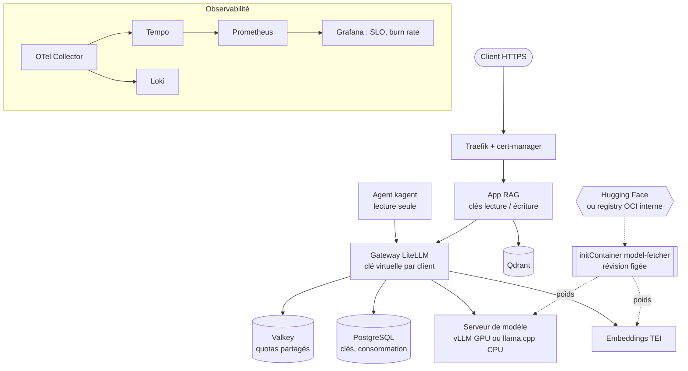

# Sovereign LLM Platform

**Une plateforme d'IA générative souveraine sur Kubernetes : un LLM auto-hébergé (Mistral 7B),
une gateway avec clés et quotas par client, une application RAG et un agent d'exploitation,
déployés en GitOps, observés par SLO, et capables de fonctionner sans aucun accès Internet.**

Le problème traité : les organisations des secteurs sensibles (santé, défense, public, finance)
veulent des LLM sans envoyer leurs données à une API externe, souvent dans des environnements
isolés. Ce projet opère toute la chaîne, du GPU jusqu'à l'utilisateur, avec les pratiques d'une
plateforme de production : tout est versionné, figé, testé et reproductible.



## Ce que démontre le projet

| Exigence | Mise en œuvre | Vérifié par |
|---|---|---|
| **Souveraineté** | Egress `default-deny` sur tout le namespace ; mode air-gapped : poids en artefacts OCI et images dans une registry interne (Zot) | audit des flux réseau, e2e : un pod ne sort pas sur Internet |
| **Idempotence** | Charts, images (digest sha256) et modèles (SHA de commit) figés ; fetcher et bootstrap rejouables sans effet ; `pin.py check` | tests unitaires, e2e (bootstrap rejoué) |
| **Scalabilité** | Serveurs de modèle en StatefulSet (un volume par réplica), gateway sans état (Valkey + PostgreSQL), PDB, autoscaling KEDA sur la file d'attente | rendu et validation des 5 overlays |
| **Agnosticisme** | Modèle = ConfigMap ; moteur = composant (vLLM / llama.cpp) ; nom logique `chat` ; ingress isolé dans un composant ; métriques des moteurs unifiées | e2e avec un autre modèle (Qwen 0.5B) |
| **Sécurité** | Secrets chiffrés dans Git (Sealed Secrets), clés API lecture/écriture, TLS, prompt balisé contre l'injection, actions CI figées par SHA, scan Trivy, SBOM | tests d'API, CI |
| **SRE** | SLO disponibilité et latence mesurés côté utilisateur, alertes multi-fenêtres par taux de consommation du budget, runbook | `promtool test rules` |
| **GitOps** | Terraform pour la plateforme, ArgoCD pour les workloads, promotion des images par commit | job `promote` |

Les choix et leurs limites sont expliqués dans [docs/decisions.md](docs/decisions.md).

## Démarrage rapide

**Prérequis** : Linux avec [k3s](https://k3s.io), `kubectl`, `terraform` ≥ 1.6, `kubeseal`, `jq`,
`make`, Python 3.11+ (`pip install pyyaml huggingface_hub`), [`crane`](https://github.com/google/go-containerregistry).
Profil `gpu` : carte NVIDIA, driver et container toolkit ([guide](docs/gpu-on-k3s.md)).
Profil `cpu` : 8 cœurs et 16 Go de RAM conseillés.

```bash
# 0. Forke le dépôt (ArgoCD le synchronise), puis :
make kubeconfig && export KUBECONFIG=$HOME/.kube/k3s.yaml

# 1. Figer les versions (révisions de modèles, digests d'images) et pousser
make pin OWNER=<ton-compte-github>
git commit -am "chore: versions figées" && git push
#    Attendre la CI verte : elle publie rag-app / platform-tools et inscrit leurs digests.
git pull

# 2. Plateforme
cp infra/terraform/terraform.tfvars.example infra/terraform/terraform.tfvars   # à adapter
make infra-init infra-apply PROFILE=gpu            # ou PROFILE=cpu

# 3. Secrets chiffrés dans Git, puis ArgoCD déploie le reste
HF_TOKEN=hf_xxx make seal-secrets                  # HF_TOKEN : modèle Mistral "gated"
git add deploy/secrets && git commit -m "chore: secrets scellés" && git push
make backup-sealing-key                            # clé de déchiffrement, à mettre en lieu sûr
make status                                        # 1er démarrage : téléchargement des poids
```

Le push sur `main` déclenche la CI, qui publie les images `rag-app` et `platform-tools`, rejoue
les tests de bout en bout et inscrit les nouveaux digests dans Git : ArgoCD déploie ce commit.

**Mode air-gapped** (aucun accès Internet depuis les workloads) : voir [docs/airgap.md](docs/airgap.md).

## Utilisation

```bash
make trust-ca                                      # CA locale, pour HTTPS sans avertissement
make demo-ingest                                   # indexe la doc du projet dans le RAG
make demo-ask Q="Comment le GPU est-il exposé aux pods sur k3s ?"
make bench LABEL="RTX 4090 / BF16"                 # TTFT et débit, à reporter dans docs/benchmark.md
make grafana                                       # dashboard SLO, moteur, GPU
make kagent-ui                                     # agent cluster-doctor
```

Réponse de `/ask`, au format garanti par le décodage contraint :

```json
{
  "answer": "Le device plugin du GPU Operator annonce la ressource nvidia.com/gpu ...",
  "sources": ["S1", "S3"],
  "confidence": "high",
  "citations": [{"id": "S1", "source": "docs/gpu-on-k3s.md", "score": 0.874}]
}
```

## Structure

```
infra/terraform/          Plateforme : cert-manager, Sealed Secrets, ArgoCD, observabilité, GPU, KEDA, Zot, kagent
deploy/base/              Socle : gateway (+ Valkey, PostgreSQL, clés), embeddings, Qdrant, RAG, NetworkPolicies, SLO
deploy/components/        Briques interchangeables : serving-gpu|cpu, model-source-hf|oci, model-*, ingress, KEDA, image-pins
deploy/overlays/          Profils déployables : gpu, gpu-airgap, cpu, cpu-airgap, ci
deploy/agents/            Agent kagent et sa configuration de modèle
deploy/secrets/           SealedSecrets de ton cluster (générés par make seal-secrets)
apps/rag/                 API RAG (FastAPI, OpenTelemetry GenAI, Qdrant)
apps/platform-tools/      model-fetcher (initContainer) et bootstrap des clés LiteLLM
scripts/                  pin.py, seal-secrets, stage-models, mirror-images
tests/                    e2e (kind), tests des alertes (promtool), tests des scripts
docs/                     GPU sur k3s, air-gapped, décisions d'architecture, runbook, benchmarks
```

## Qualité

| Commande | Contenu |
|---|---|
| `make test` | 59 tests unitaires : API (auth, schéma), RAG contre un vrai Qdrant embarqué, fetcher, bootstrap, scripts |
| `make test-alerts` | Tests des alertes SLO sur séries synthétiques (incident, bruit de fond, pic terminé, saturation) |
| `make validate` | Rendu des 5 overlays, validation stricte des schémas (CRD comprises), puis audit : références, secrets, variables, et une vingtaine de flux réseau par overlay (requis ouverts, interdits bloqués) |
| `make e2e-local` | Déploiement réel sur kind avec un petit modèle, puis tests fonctionnels et de sécurité |
| `make lint` | ruff, shellcheck, `terraform fmt` |

## Feuille de route

- [ ] Routage tenant compte du KV cache entre réplicas (llm-d / Gateway API Inference Extension)
- [ ] Allocation des GPU par DRA (Dynamic Resource Allocation), cible de la conformance IA CNCF
- [ ] Évaluation automatique de la qualité RAG en CI (jeu de questions de référence)
- [ ] Signature des images (cosign) et politique d'admission (Kyverno)
- [ ] Archive air-gapped transportable (Zarf ou Hauler) pour un premier déploiement sans amorçage connecté

## Licence

Apache 2.0
